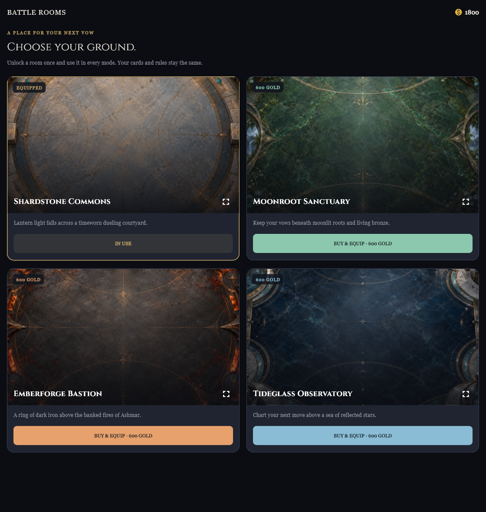

# SHARDFALL 0.2.2+67 — Battle Rooms dan kurva Story

Default arena sekarang memakai **Shardstone Commons**, pelataran batu dengan ukiran perunggu dan cahaya lentera. Menu Home **BATTLE ROOMS** menyediakan tiga ruangan premium, masing-masing **600 Gold**, dibeli sekali dan dapat dipakai bergantian tanpa biaya tambahan:

| Ruangan | Arah visual |
|---|---|
| Moonroot Sanctuary | Batu hijau, akar, bunga kecil, dan perunggu hidup di bawah cahaya bulan |
| Emberforge Bastion | Besi gelap, obsidian, dan pantulan bara di tepian arena |
| Tideglass Observatory | Tideglass biru malam, marmer, dan lingkaran astronomi |

Preview tidak membelanjakan Gold atau mengganti pilihan. Pembelian memerlukan konfirmasi, menampilkan kekurangan Gold, dan melindungi pembelian dari ketukan berulang. Kepemilikan dan pilihan disimpan bersama profil serta masuk backup dan cloud snapshot. Save lama memperoleh default gratis. Ruangan yang tidak dikenal atau belum dimiliki kembali ke default. Kegagalan penyimpanan pembelian mengembalikan Gold dan pilihan sebelumnya.

Semua mode memakai latar bersama melalui DuelScreen: Story, Practice, Duel, Arena, Daily, dan PvP. Ruangan hanya kosmetik. Katalog kartu, aturan, hadiah, deck lawan, dan balance antar-faction tidak berubah dari 0.2.1. Nama lawan panjang kini dipotong dengan elipsis dan dapat dilihat utuh melalui tooltip; tombol riwayat/menyerah tetap terlihat. Penanda fase menyesuaikan lebar layar kecil.

## Story

Seluruh **140 encounter** diperiksa ulang dengan dua kebijakan AI. Setup tetap per encounter memperbaiki lonjakan kesulitan tanpa mengubah chapter, narasi, urutan adegan, VO, identitas pasukan musuh, atau deck pinjaman. Yang disesuaikan hanya Health awal, giliran pertama, dan paling banyak tiga unit bantuan. Briefing menampilkan setup sebenarnya; tidak ada penyesuaian tersembunyi berdasarkan kekalahan atau profil.

**112.000 simulasi**, termasuk baseline dan tiga audit akhir, selesai tanpa stall. Hasil Tactician pada seed holdout yang disimpan sebelum pengujian:

| Kelompok | Rentang kemenangan | Rata-rata |
|---|---:|---:|
| Pengenalan | 72–89% | 82,1% |
| Pertempuran biasa | 59–73% | 64,7% |
| Tantangan | 40–64% | 52,4% |

Angka tersebut mengukur kebijakan AI, bukan jaminan tingkat kemenangan manusia atau semua deck buatan pemain. Enam encounter sedikit keluar dari rentang sasaran dan tetap dilaporkan; hasil holdout tidak dipakai untuk menyetel ulang setup. Kebijakan Greedy juga dilaporkan lengkap karena kekuatannya tidak selalu di bawah Tactician. Metode, interval ketidakpastian, durasi, semua hasil per pertandingan, serta setup yang dibekukan ada di [laporan Story](story-difficulty-0.2.2/README.md).

## Tampilan dan beban gambar

Empat gambar WebP berjumlah **1.569.348 byte**. Setiap battle memuat satu gambar statis dengan batas decode lebar 1024 pixel, sekitar 4 MiB untuk pixel RGBA persegi. Thumbnail memakai lebar 480. Tidak ada video, animasi latar berulang, blur, atau unduhan gambar saat bertarung. Latar mempunyai batas repaint tersendiri; tes dengan 100 pembaruan Health pada controller duel mempertahankan picture yang sama tanpa repaint latar tambahan. Ini bukti isolasi rendering, bukan pengukuran FPS perangkat Android.

Ilustrasi dibuat melalui built-in image_gen, diperiksa satu per satu, lalu dikonversi ke WebP tanpa crop atau resize. [Prompt lengkap, master, ukuran, dan hash](../../tools/art_pipeline/battle_room_art_ledger.json) tersedia untuk keempat gambar.

Pemeriksaan visual menggunakan widget Flutter sebenarnya, aset dan font proyek, pada 390×844 dan 1120×1180 untuk toko serta 390×844 dan 1280×720 untuk arena. Browser tidak dapat dibuka karena pembatasan akses host pada sesi ini; pemeriksaan browser tidak diklaim untuk rilis ini. PNG widget-test juga memiliki keterbatasan fallback font: simbol pedang lama sebelum Combat tampil sebagai kotak, sehingga gambar ini membuktikan layout, bukan fallback font setiap platform.

- [Toko ponsel](previews/battle-room-shop-phone-0.2.2.png)
- [Default](previews/battle-room-classic-0.2.2.png), [Moonroot](previews/battle-room-moonroot-0.2.2.png), [Emberforge](previews/battle-room-emberforge-0.2.2.png), [Tideglass](previews/battle-room-tideglass-0.2.2.png)
- [Arena layar lebar](previews/battle-room-wide-0.2.2.png)

## Verifikasi

**445 tes lulus**: 306 aplikasi, 97 engine, 32 backend, tiga pipeline VO, dan tujuh auditor kemampuan kartu. Satu tugas visual tambahan menghasilkan tujuh PNG tanpa overflow. Tes ruangan mencakup pembelian, kekurangan Gold, ketukan bersamaan, kegagalan simpan, backup/cloud, migrasi, preview tanpa transaksi, pergantian/default, lebar 320 pixel, dan isolasi repaint. Review independen tidak menemukan masalah yang perlu diperbaiki, termasuk setelah koreksi header dan penanda fase.

Analisis aplikasi tidak menemukan error atau warning; dua info lint lama pada alat narasi offline tetap ada, begitu pula dua info import pada alat engine. Build web berhasil dengan peringatan font CupertinoIcons yang sudah ada; tampilan memakai ikon Material. Paket Android tetap perlu playtest perangkat untuk mengukur FPS dan pengalaman bermain manusia.

Manifest Story memastikan seluruh 33 berkas sumber yang dibekukan tetap cocok setelah audit. Ilustrasi kartu/cerita/token, 936 VO, serta kedua katalog kartu tetap sama. Rincian paket, tanda tangan produksi, hash, dan pemeriksaan byte aset ada di [release-verification-0.2.2.json](release-verification-0.2.2.json).

Log rilis akhir: [306 tes aplikasi](verification-0.2.2/app-tests.txt), [97 tes engine](verification-0.2.2/engine-tests.txt), [32 tes backend](verification-0.2.2/backend-tests.txt), [pipeline VO](verification-0.2.2/voice-tests.txt), [analisis](verification-0.2.2/app-analysis.txt), [14 tes ruangan](verification-0.2.2/room-tests.txt), dan [tugas visual](verification-0.2.2/visual-proof.txt).

Hasil lokal: `app/build/releases/five-vows-0.2.2+67/`, berisi APK, Android App Bundle, dan web. Tidak ada deploy remote atau publikasi ke store. Berkas edit lokal pengguna dan untracked yang sudah ada tetap dipertahankan.
