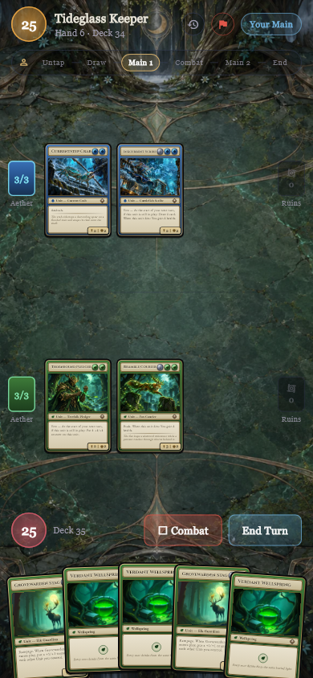

# SHARDFALL 0.2.3+68 — Ilustrasi arena saat battle

Pengguna meminta arena saat bermain terlihat sekaya preview. Pemeriksaan pada HP Android 2201117TY (1080×2400, density 440) memperlihatkan bahwa default Shardstone Commons masih aktif, sedangkan Moonroot dan Emberforge dilihat melalui preview premium. Selain perbedaan tema aktif, battle menambahkan vignette radial, cincin, dan pita tengah prosedural di atas ilustrasi yang tidak terdapat pada preview.

Perbaikan berfokus pada arena sebenarnya:

- Menghapus lapisan papan prosedural tambahan beserta bayangannya. Ilustrasi ruangan kini menjadi dasar visual yang sama pada preview dan battle.
- Mengurangi gelap di bagian atas/bawah gambar agar arsitektur, akar, bara, dan marmer lebih terlihat. Bagian tengah default dan Moonroot sedikit diperjelas.
- Memperhalus garis pemisah kedua pemain. Posisi, ukuran, interaksi kartu, tombol, dan aturan permainan tetap sama.
- Mempertahankan gambar proporsional dengan `BoxFit.cover`; gambar tidak diregangkan. Sebagian tepian tetap terpotong sesuai orientasi layar. Tidak ada ilustrasi baru, video, ticker, efek blur, atau unduhan tambahan.

Empat WebP tetap berjumlah 1.569.348 byte, dengan batas decode 1024 pixel. Menghapus painter mengurangi lapisan render. Tes 100 pembaruan status tetap mempertahankan picture latar yang sama tanpa repaint tambahan; FPS Android tidak diukur.

## Verifikasi

Regresi visual terlebih dahulu gagal pada sumber 0.2.2: titik kosong pada arena default menghasilkan RGBA `[74,61,50,255]`, sementara dasar preview menghasilkan `[103,85,69,255]`. Setelah perbaikan, tiga titik permukaan bermain cocok byte demi byte untuk semua empat ruangan pada 390×844 dan 1280×720. Controller tidak berubah selama pemeriksaan tersebut.

**307 tes aplikasi lulus**, termasuk 15 tes ruangan/persistensi/UI. Satu tugas render tambahan menghasilkan tujuh PNG tanpa overflow. Analisis aplikasi hanya melaporkan dua info lint lama pada alat narasi offline. Review independen tidak menemukan regresi yang perlu diperbaiki. Seluruh 33 hash sumber Story, kartu, dan engine dari audit 0.2.2 tetap cocok; kurva kesulitan, katalog, VO, dan gameplay tidak disetel ulang.

Hasil engine/backend/VO/auditor dari rilis 0.2.2 tetap dicatat sebagai hasil komponen yang tidak berubah, bukan diklaim sebagai pengujian baru. Bukti rilis ada di [release-verification-0.2.3.json](release-verification-0.2.3.json); log baru ada di [verification-0.2.3](verification-0.2.3/).

## Tampilan battle terbaru

Ini render DuelScreen sebenarnya, dengan controller dan kartu asli, bukan gambar rancangan. Capture widget-test masih mempunyai batasan fallback font untuk simbol pedang lama sebelum tombol Combat.

- [Default](previews/battle-room-classic-0.2.3.png)
- [Moonroot](previews/battle-room-moonroot-0.2.3.png)
- [Emberforge](previews/battle-room-emberforge-0.2.3.png)
- [Tideglass](previews/battle-room-tideglass-0.2.3.png)
- [Tideglass layar lebar](previews/battle-room-wide-0.2.3.png)

Ilustrasi sumber dan [prompt/master/hash](../../tools/art_pipeline/battle_room_art_ledger.json) tetap sama. Paket lokal 0.2.3+68 tersedia di `app/build/releases/five-vows-0.2.3+68/`.

APK 0.2.3+68 berhasil dipasang pada HP yang terhubung dan versi 68 diverifikasi melalui package manager. Pemeriksaan visual lanjutan pada HP dihentikan sesuai permintaan pengguna, yang memilih memeriksanya sendiri. APK dan App Bundle memakai sertifikat produksi yang sama; APK, App Bundle, dan web masing-masing cocok dengan 1.181 aset sumber.
