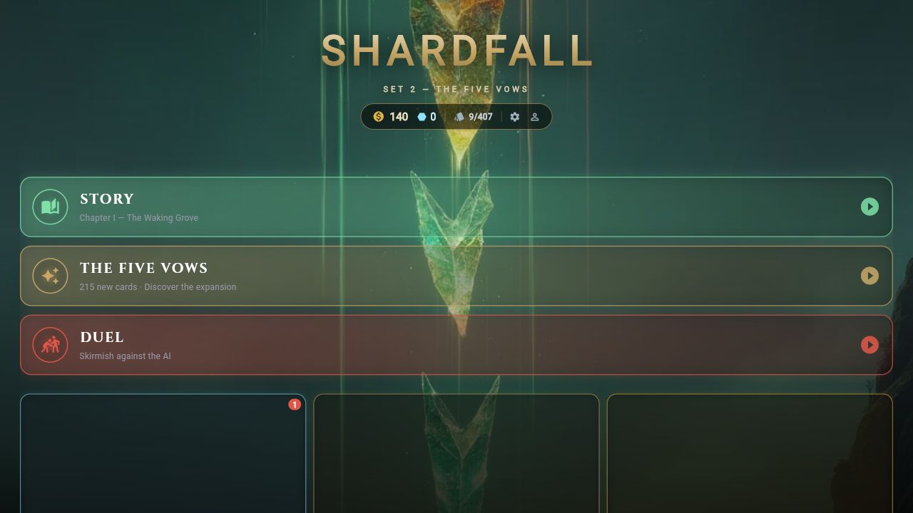
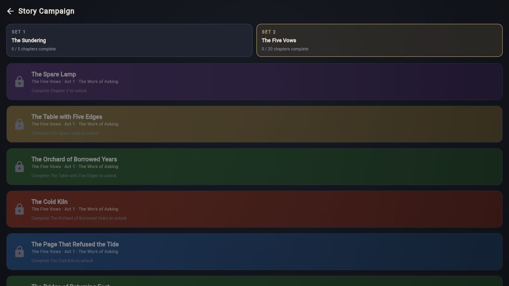

# SHARDFALL 0.2.1+66 — Set 2 polish and balance

Pembaruan lokal untuk The Five Vows di atas commit `7ac542ce4323726cf70398bc2d054b11d0e5dd40`. Struktur giliran, combat, resource, harga booster, kepemilikan, dan progres campaign mengikuti permainan yang sudah ada.

## Tampilan dan campaign

Home menampilkan **SET 2 — THE FIVE VOWS**. Menu Story memiliki pilihan **Set 1 / The Sundering** (5 chapter) dan **Set 2 / The Five Vows** (20 chapter). Pilihan awal mengikuti chapter berikutnya yang belum selesai. Set 2 tetap membutuhkan penyelesaian Chapter V; memilih tab tidak membuka chapter yang terkunci. Pengujian mencakup lebar 320 piksel, perpindahan set, batas unlock, dan navigasi.

Peta chapter menyediakan **Story loan deck** sebagai pilihan awal, serta deck koleksi tersimpan yang legal. Deck koleksi dapat menggabungkan kartu kedua set di campaign mana pun. Pemeriksaan mengikuti aturan Deck Builder: 40–60 kartu yang dikenal, maksimal dua Dominion, maksimal 20 Wellspring, batas salinan 3 atau 1 untuk Legendary, dan kepemilikan kartu non-resource. Lawan, papan pembuka, reward, resume, replay, animasi, dan rekaman cerita tetap mengikuti encounter yang ditulis.

## Kartu pada semua mode

- Duel, Arena, dan lawan Daily Gauntlet kini memakai generator deck dari kedua set. Setiap faction mendapat kerangka sama: 40 kartu, 16 resource, 16 unit, 8 spell, kurva awal yang bisa dimainkan, dan salinan Legendary yang legal. Seed membuat hasil dapat diulang. Kartu 6–8 mana mempunyai slot finisher.
- Draft Arena sudah menawarkan seluruh pool kartu; resource tambahan kini memakai ilustrasi Wellspring dari kedua set.
- Daily loan deck kini memasukkan kartu 7–8 mana ke kelompok finisher 6+, dan memilih varian resource kedua set secara deterministik. Tes sebelumnya benar-benar gagal karena 21 kartu ekspansi tidak dapat muncul di Daily; tes setelah perbaikan membuktikan seluruh 215 kartu dapat terpilih.
- Deck koleksi pada Duel, Deck Builder, Forge, dan PvP memakai katalog gabungan. Tes tambahan melewatkan seluruh 215 definisi melalui penyimpanan server dan proyeksi client PvP yang sebenarnya; teks, definisi efek, dan status Vow tetap sesuai katalog. Ini pengujian kode lokal, tanpa publikasi server baru.

## Istilah dan audit duplikasi

Istilah baku adalah **in play**: `When {name} enters play, ...` dan `if this unit is still in play`. “Battle” dapat berarti pertarungan saja, sedangkan “Arena” juga nama mode draft; “in play” menyatakan keberadaan unit sepanjang giliran dengan lebih jelas. Nama kartu menggantikan `{name}` pada wajah kartu, informasi lengkap, dan pembaca layar. Glossary menjelaskan Vow dan waktu penggunaan Renew setelah combat pada Main kedua.

Set 1 menerima 34 perubahan teks masuk permainan. Hash seluruh identitas, biaya, angka status, keyword, dan efek Set 1 tetap sama dengan sebelum pembaruan: `f9b6cc67c3f8c409f1d86d37feb8e3235f32e5ece7b1dd1d7382575d97020c97`.

Audit kemampuan mengabaikan nama, gambar, flavor, biaya, angka might/guard, dan pertukaran warna faction. Default JSON lama, target tersirat pada teks, kelompok trigger yang ekuivalen, serta nama token juga dinormalisasi. Urutan efek, waktu trigger, angka efek, target, dan keyword tetap bermakna. Pemeriksaan tambahan antarset bahkan mengabaikan perbedaan jenis Rite/Ritual, sehingga perubahan kecepatan spell tidak menyembunyikan efek lama.

Hasil: **0 duplikasi paket kemampuan antara Set 1 dan Set 2**, termasuk pemeriksaan tambahan tersebut, serta **0 paket kemampuan identik di dalam Set 2 setelah memperhitungkan waktu penggunaan kartu**. Dua spell internal yang sama-sama menghancurkan unit mempunyai waktu penggunaan berbeda (Ritual dan Rite); keduanya tidak menyalin paket Set 1. Lima Wellspring dasar merupakan pengecualian resource yang disengaja. Efek Aether dasarnya dipertahankan.

Revisi ekspansi ditulis di [`set02_revisions.json`](../../data/cards/set02_revisions.json), dengan alasan setiap perubahan. Contoh: Tidal Reading mengambil satu kartu dan satu Wellspring; Nightglass Reading menukar informasi dengan discard lawan serta biaya Health. Beberapa hasil Vow ditunda, tubuh unit ditata ulang, dan The Gate Remains membutuhkan 6 Aether agar penguatan pasukan Set 1 tidak terlalu murah. Identitas, flavor, adegan ilustrasi, dan subtype seluruh 215 kartu tetap dipertahankan.

## Balance yang diuji

Kartu dibekukan sebelum seed akhir `2026102931` dijalankan. Seed referensi `2026102901` dan validasi `2026102902` digunakan saat tuning. Hash sumber SF002 akhir adalah `337f044c308c58f21c286af0e980a32dbbbc180365fb187ef45198eed0a18f63`; salinan aplikasi identik. [Manifest input](balance-0.2.1/inputs.json) mencatat sumber dan metode.

| Faction | Panel utama, validasi | Panel utama, holdout | Deck campuran acak, validasi | Deck campuran acak, holdout |
| --- | ---: | ---: | ---: | ---: |
| Verdance | 51.56% | 50.12% | 46.88% | 45.38% |
| Pyre | 50.86% | 50.51% | 49.56% | 49.75% |
| Tide | 48.16% | 49.80% | 50.31% | 51.94% |
| Dawn | 49.84% | 50.90% | 56.81% | 55.00% |
| Gloom | 49.57% | 48.67% | 46.44% | 47.94% |

Panel utama memakai 20 deck yang ditetapkan sebelumnya: tempo, value, rare, dan campuran Set 1/2 untuk setiap faction. Semua 160 pasangan lintas faction dan lintas jenis deck dimainkan, 40 pertandingan per pasangan, dengan giliran pertama bergantian. Masing-masing referensi, validasi, dan holdout berisi **6.400 pertandingan**. Panel mode memakai generator lawan yang dipakai produk: **4.000 pertandingan validasi** dan **8.000 holdout**, dengan pasangan deck dicerminkan giliran pertamanya. Semua panel tersebut memiliki **0 pertandingan macet**.

Pemeriksaan terpisah mengadu starter lama melawan lawan campuran: **5.000 pertandingan validasi** dan **10.000 holdout**. Starter lama masih dapat menang; pada holdout angkanya 51.0–65.65% menurut faction. Ini pemeriksaan kesulitan lawan, bukan klaim bahwa semua starter mempunyai kekuatan yang sama.

Hasil tersebut mendukung keseimbangan faction pada panel akhir, tetapi tidak membuat setiap susunan deck setara. Deck individual pada panel utama holdout berada di **42.03–59.69%**; Dawn mencapai **56.81%** pada panel mode validasi sebelum **55%** pada holdout. Keunggulan formasi Dawn dan deck Rare Tide masih perlu diamati melalui permainan manusia. Autoplay juga tidak sepenuhnya mewakili pemain yang menyimpan Aether untuk respons atau Renew setelah combat. Tidak ada hasil matchup yang disembunyikan atau dibuang.

Laporan lengkap: [baseline](balance-0.2.1/baseline.json), [referensi akhir](balance-0.2.1/reference.json), [validasi](balance-0.2.1/validation.json), [holdout](balance-0.2.1/holdout.json), [mode validasi](balance-0.2.1/modes-validation.json), [mode holdout](balance-0.2.1/modes-holdout.json), dan [audit kemampuan](balance-0.2.1/ability-audit.json).

## Verifikasi dan hasil build

- Aplikasi: **286 tes lulus**; engine: **97**; backend PvP: **32**; pipeline VO: **3**; audit Python: **7**. Total **425**.
- Analisis aplikasi dan engine tidak mempunyai error/warning; hanya empat informasi lama pada alat offline. Analisis backend bersih.
- Empat puluh encounter cerita diuji pada 40 seed: **1.600 pertandingan**, **1.193 kemenangan**, **0 macet**, dan semua encounter dapat dimenangkan. [Hasil per encounter](balance-0.2.1/story.csv).
- **239 ilustrasi dan 239 master** berhasil dibaca, dengan hash ilustrasi yang unik. Tidak ada perubahan berkas art atau VO pada pembaruan ini. Seluruh 215 ilustrasi kartu, 20 gambar chapter, 4 gambar token, dan 936 klip suara tetap tersedia.
- Home serta kedua tab Story diperiksa di build web sebenarnya. Pemeriksaan terpisah meninjau unlock, deck tersimpan, placeholder nama, dan jangkauan kartu semua mode.

Hasil rilis lokal berada pada `app/build/releases/five-vows-0.2.1+66/`: APK universal, App Bundle, dan folder web. APK/App Bundle memakai sertifikat rilis produksi yang sama dengan 0.2.0+65. Lihat [`release-verification-0.2.1.json`](release-verification-0.2.1.json) untuk ukuran, hash, hasil tanda tangan, dan pemeriksaan katalog dalam paket. Tidak ada push, deploy server, atau publikasi toko pada pembaruan lokal ini.

Untuk mengulang pemeriksaan: `python -m unittest discover -s tools/card_audit -p test_ability_audit.py`; dari folder engine jalankan `dart test`, `dart run bin/expansion_archetypes.dart 40 2026102931`, dan `dart run bin/mode_balance.dart 400 2026102931`; dari folder aplikasi jalankan `flutter test` dan `dart tool/five_vows_story_sim.dart --games=40 --seed=2026102931`.
